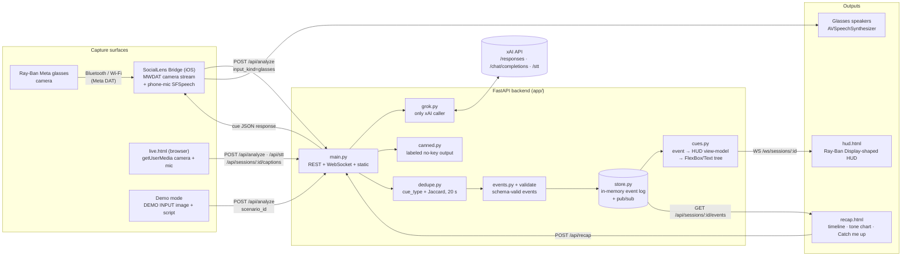
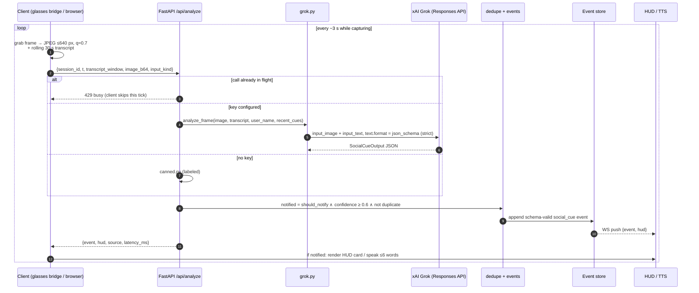
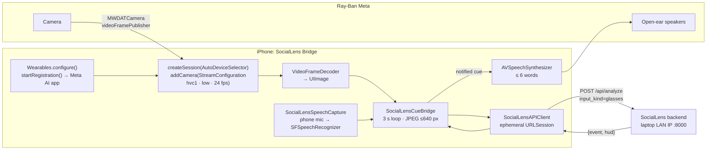
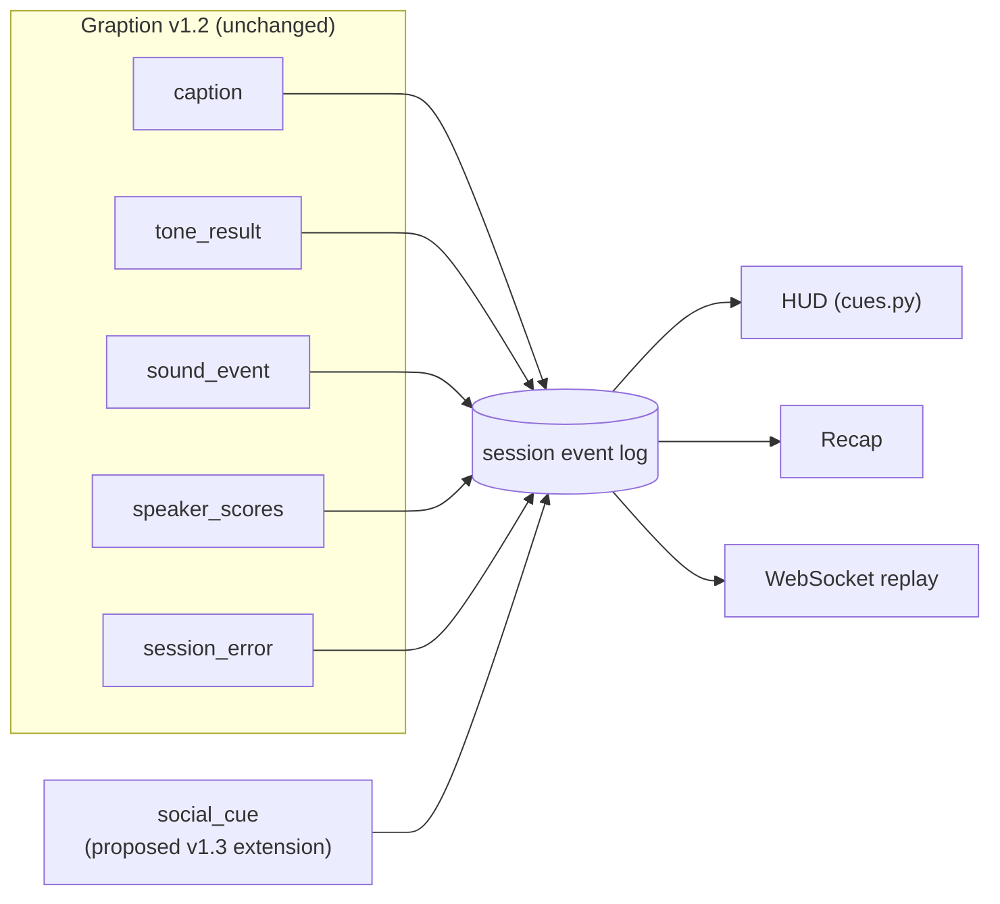

# SocialLens

**A live, multimodal social-cue copilot for Ray-Ban Meta glasses, the phone, and the browser, built on Grok.**

Captions tell a Deaf or hard-of-hearing (DHH) person *what* was said. They don't say that a question was aimed at you, that a line was sarcastic, or that someone across the room is waving. SocialLens fills that gap. Every ~3 seconds it sends Grok one camera frame (from the glasses, a phone, or a laptop webcam) plus the last ~30 seconds of transcript. Grok sends back at most **one** short cue with the evidence for it, such as *"They asked you to dinner Friday"* with the suggestion *"Say: I'd love to! What time?"*. The cue appears on a HUD, or is spoken through the glasses speakers. Every cue is also written to the session event log, so a **Recap** dashboard can catch you up afterwards.

SocialLens extends **Graption**, BDBI's speaker-aware captioning project. It uses Graption's event schema (v1.2) unchanged and proposes one new event type, `social_cue`. It was built for the BDBI x SpaceXSI Grokathon.

> **Secondary, opt-in users:** autistic or socially anxious people who *choose* to get gentle cues and suggested replies. SocialLens supports the user. It never scores or corrects them.

---

## Contents

- [What it does](#what-it-does)
- [Tech stack](#tech-stack)
- [System architecture](#system-architecture)
- [Live multimodal AI pipeline](#live-multimodal-ai-pipeline)
- [Meta glasses and the Wearables Device Access Toolkit](#meta-glasses-and-the-wearables-device-access-toolkit)
- [Event model](#event-model)
- [Quick start](#quick-start)
- [API reference](#api-reference)
- [Repository layout](#repository-layout)
- [Testing and validation](#testing-and-validation)
- [Privacy and ethics](#privacy-and-ethics)
- [Status and roadmap](#status-and-roadmap)
- [Further docs](#further-docs)

---

## What it does

| Feature | Description |
|---|---|
| **Live mode** (`web/live.html`) | The browser captures the camera and mic, keeps a rolling 30 s transcript (xAI speech-to-text via the backend, Web Speech, or typed input), and sends a frame every 3 s to `/api/analyze`. A red **"● Capturing"** badge is visible whenever capture tracks are live, with a consent screen before capture and a one-tap Stop/discard. |
| **Glasses mode** (iOS bridge) | The **SocialLens Bridge** iPhone app streams the Ray-Ban Meta camera through Meta's Wearables Device Access Toolkit. Every ~3 s it sends a JPEG and the phone-mic transcript to the same `/api/analyze` endpoint, then speaks notified cues through the glasses speakers. |
| **Demo mode** (`web/demo/`, built into live) | Three scripted scenarios (dinner invite, sarcasm, wave), each with an image labeled **DEMO INPUT** and a fixed transcript. With a key they go to Grok. Without one you get canned outputs labeled as canned, so the demo also works offline. |
| **HUD** (`web/hud.html`) | A dark ~600×600 panel shaped like the Meta Ray-Ban Display: an icon, a one-line cue (≤ 60 chars), a "Say: …" reply and a "model guess" footnote. It subscribes to the session WebSocket and mirrors live and demo sessions. |
| **Recap / "Catch me up"** (`web/recap.html`) | Shows a speaker timeline, a tone-over-time chart (Chart.js), sound-event and social-cue markers, and real-time replay. **Catch me up** asks Grok for a structured summary: per-speaker notes, moments addressed to you, action items and tone highlights. With no key it falls back to a rule-based summary. |
| **Graption event log** | Every caption, tone result, sound event and social cue is a JSON-Schema-validated event in one in-memory log per session. |

---

## Tech stack

| Layer | Technology | Notes |
|---|---|---|
| **AI: vision and reasoning** | **xAI Grok**, [Responses API](https://docs.x.ai) (`POST /v1/responses`) | `input_image` (JPEG data URL) + `input_text`, with strict `json_schema` structured output. Default model `grok-4.20-0309-non-reasoning`, chosen for live latency. Set `XAI_MODEL` to change it. |
| **AI: recap** | Grok Chat Completions (`POST /v1/chat/completions`) | `response_format: json_schema` returns a typed `RecapOutput`. |
| **AI: speech-to-text** | Grok STT (`POST /v1/stt`, `grok-voice-transcribe-2.0`) | Proxied through `/api/stt` so the key never reaches the browser. The browser records with MediaRecorder, resamples to 16 kHz WAV, and uploads a chunk about every 3 s. |
| **Backend** | Python 3.11+, **FastAPI**, Uvicorn, **httpx** (async), Pydantic, **jsonschema**, python-dotenv | One process serves the REST API, the WebSocket stream and the static frontend. All xAI calls are in `app/grok.py`. |
| **Realtime** | FastAPI WebSockets | `WS /ws/sessions/{id}` pushes `{event, hud}` as events are appended, or replays a stored log in real time (`?replay=1&speed=…`). |
| **Frontend** | Plain HTML + vanilla ES modules, **no build step** | `getUserMedia`, MediaRecorder, Web Audio (WAV encoding), `webkitSpeechRecognition` fallback, Chart.js 4 from a CDN. |
| **Native bridge** | **Swift 6.3 / SwiftUI**, iOS 17.2+, Xcode 26.4+ | Based on Meta's official CameraAccess sample. Uses **Meta Wearables Device Access Toolkit 1.0.1** (`MWDATCore`, `MWDATCamera`, `MWDATMockDevice`), Apple `Speech` (`SFSpeechRecognizer`), and `AVSpeechSynthesizer`. |
| **Data contracts** | JSON Schema Draft 2020-12 | Graption `events.schema.json` v1.2 (unchanged) + `social_cue.schema.json` extension. |
| **Tests** | pytest | Schema, dedupe, HUD cue mapping, Grok client (mocked) and the full API. |

---

## System architecture



**Design choices**

- **Web first, glasses second.** The browser gives us camera, mic and speech with nothing to install, so the demo can't be broken by code signing or Bluetooth pairing. The glasses bridge calls **the same API**, so the backend doesn't know or care where a frame came from.
- **The backend keeps the secret.** `XAI_API_KEY` stays on the server. The backend also enforces one in-flight analyze call per session (`429 busy`), caps image size, dedupes cues and owns the event log.
- **One event log, many views.** Live cues, captions, tone results and sound events all go into the same append-only log. The HUD, the cue list and the Recap are just different readers of it.
- **Every feature works without a key.** Canned and heuristic outputs are always labeled (`source: "canned"` / `"heuristic"`).

---

## Live multimodal AI pipeline

### One cue, end to end



### What Grok sees and returns

The model gets three inputs: **one frame** from the user's point of view, the **last ~30 s of transcript** (oldest first), and the **user's name**, plus the last five cues already shown so it doesn't repeat itself. The system prompt (`app/prompts.py`, from [PROMPTS.md](PROMPTS.md)) asks for at most one cue and makes `none` the default:

| `cue_type` | Example cue |
|---|---|
| `question_to_you` | "They asked you to dinner Friday" → *Say: I'd love to! What time?* |
| `sarcasm_or_joke` | "That sounded sarcastic: they're joking about the meeting" |
| `greeting_gesture` | "Someone is waving at you" |
| `turn_taking` | "Pause: it may be your turn to speak" |
| `other` / `none` | Anything else useful / nothing worth interrupting for (the most common answer) |

Output is constrained by a **strict JSON schema** (`SocialCueOutput`): `cue_type`, `cue`, `visual_evidence`, `audio_evidence`, `suggested_response`, `confidence`, `should_notify`. The server then adds identity and bookkeeping (`cue_id`, `t`, `notified`, `source`, `input_kind`, `model_version`, …) to produce a full `social_cue` event.

### Fusing the two inputs

- **Vision:** gestures, posture, who is facing the user, and the scene. Never identity or facial emotion.
- **Language:** the transcript window, used to spot direct address (the user's name or "you"), questions, sarcasm and pauses.
- **Evidence for both:** each cue cites `visual_evidence` and/or `audio_evidence`, and uses `null` when an input contributed nothing. The UI shows that evidence with the cue.
- **Restraint:** server-side dedupe drops a repeat of the same `cue_type` with similar text (token Jaccard > 0.6) within `CUE_DEDUPE_WINDOW_S` (20 s). The recent-cues list sent in the prompt helps the model avoid repeats too.

### Speech sources

| Surface | Transcript source |
|---|---|
| Browser | **xAI STT** by default (MediaRecorder → 16 kHz WAV → `/api/stt` about every 3 s). Falls back to `webkitSpeechRecognition` or typed input. |
| iOS bridge | **Phone mic** → Apple `SFSpeechRecognizer`, kept in memory as a rolling window. The glasses' HFP mic is beamformed toward the wearer and suppresses other people's voices, so it isn't used here. |

### Recap ("Catch me up")

`POST /api/recap` compacts the session log (captions, tone tags, sounds, cues; trimmed to ~6k chars) and sends it to Grok Chat Completions with a strict `RecapOutput` schema. The result is an overall summary, per-speaker summaries, **moments addressed to you**, action items and tone highlights (labeled as model guesses). With no key, a heuristic summary is returned with an explicit message saying so.

---

## Meta glasses and the Wearables Device Access Toolkit

Displayless Ray-Ban Meta glasses don't expose their camera to a browser. To get their camera feed we ship a **thin native iOS bridge**, **SocialLens Bridge**, built from Meta's official [`meta-wearables-dat-ios`](https://github.com/facebook/meta-wearables-dat-ios) **CameraAccess** sample (Device Access Toolkit **1.0.1**, pinned in `Package.resolved`).



**SDK modules used:** `MWDATCore` (registration, permissions, device sessions), `MWDATCamera` (camera stream and photo capture), `MWDATMockDevice` (simulated glasses for development). `MWDATDisplay` (Meta Ray-Ban Display only) is the next target. See below.

**What we added to the sample** (`ios/CameraAccess/CameraAccess/SocialLens/`):

| File | Role |
|---|---|
| `SocialLensCueBridge.swift` | `@Observable` loop: every 3 s it grabs the latest decoded frame, JPEG-encodes it off the main actor, posts it with the transcript window, and speaks notified cues. Supports pause/resume and stop-and-delete-session. |
| `SocialLensAPIClient.swift` | An `actor` wrapping session create/delete and `/api/analyze`. Uses an ephemeral `URLSession` with a 90 s timeout and never logs image bytes. |
| `SocialLensSpeechCapture.swift` | Phone-mic `AVAudioEngine` → `SFSpeechAudioBufferRecognitionRequest` → rolling transcript, kept in memory only. |
| `CameraView.swift` / `CameraViewModel.swift` (edits) | A SocialLens settings sheet (backend base URL, on/off, status, latency, last cue, transcript preview) and a **"Capturing → SocialLens"** status chip. |

**Output on each glasses model**

- **Ray-Ban Meta (no display):** the cue is spoken through the glasses' open-ear speakers via `AVSpeechSynthesizer`, cut to ~6 words ("Question for you: dinner Friday").
- **Meta Ray-Ban Display (planned):** `app/cues.py` already outputs a `FlexBox` / `Text(style: .heading/.body/.meta)` tree that matches the `MWDATDisplay` components, so sending it with `session.addDisplay()` → `display.send(view)` should be a direct translation. The browser HUD renders the same tree today.

### Requirements

- macOS with Xcode 26.4+, Swift 6.3+
- iPhone on iOS 17.2+ with the **Meta AI** app installed
- Supported Ray-Ban Meta glasses paired in Meta AI, with **Developer Mode** on (Meta AI → **Settings → Your glasses → Developer Mode**)

### Run with real glasses

1. Start the backend bound to your LAN (see [Quick start](#quick-start)): `scripts/run_backend.sh` listens on `0.0.0.0:8000`.
2. Open `ios/CameraAccess/CameraAccess.xcodeproj` in Xcode and select the `CameraAccess` target.
3. Under **Signing & Capabilities**, pick your Apple development team. If `com.sociallens.app` isn't available to your team, use a unique bundle ID.
4. Run on your iPhone. In **SocialLens Bridge**, tap **Connect** and finish registration in Meta AI.
5. Tap **Start Session**, then **Preview**.
6. Open the SocialLens settings sheet and set **Base URL** to `http://<your-laptop-LAN-IP>:8000`. On a physical device, `localhost` is refused.
7. While the preview streams, cues are spoken through the glasses. The status line shows `source · latency · cue_type · vision+transcript`.

Developer Mode needs no `META_APP_ID` or `CLIENT_TOKEN`; leave both unset for development. Release channels need credentials from the Wearables Developer Center. Keep them in local Xcode build settings and **never commit them**.

### Run without glasses

Build the Debug configuration and tap the ladybug button to open **Mock Device Kit**. It pairs a simulated Ray-Ban Meta and feeds the bundled test image/video as the camera stream, so the whole pipeline (frames → Grok → TTS) can be tested at a desk.

The internal Xcode target is still named `CameraAccess` so upstream sample updates stay easy to merge. The installed app is named **SocialLens Bridge**. Meta's developer terms are kept in [`ios/META_WEARABLES_LICENSE.md`](ios/META_WEARABLES_LICENSE.md). More detail: [GLASSES_INTEGRATION.md](GLASSES_INTEGRATION.md).

---

## Event model

SocialLens events sit next to Graption's existing ones. Times are **seconds since session start**.



```json
{"type":"social_cue","session_id":"live-ab12cd34","schema_version":"1.2",
 "cue_id":"6f1c2a9e-1d3b-4c55-9a43-2b7f6f0e9a01","t":15.0,
 "cue_type":"question_to_you","cue":"They asked you to dinner Friday",
 "visual_evidence":"Person facing the camera, looking toward you",
 "audio_evidence":"\"Vaibhav, want to come to dinner Friday?\"",
 "suggested_response":"I'd love to! What time?","confidence":0.92,
 "should_notify":true,"notified":true,"speaker_id":"unknown",
 "related_caption_id":"0b8e3f52-5c1a-4f0e-8d0a-6c9a1e2b7c33",
 "source":"grok","input_kind":"live_camera","model_version":"grok-4.7"}
```

`input_kind` is one of `live_camera`, `demo_input`, `glasses` or `audio_only`. `validate.py` routes `social_cue` events to `schemas/social_cue.schema.json` and all other events to Graption's `schemas/events.schema.json`. Full field reference: [EVENT_SCHEMA.md](EVENT_SCHEMA.md).

---

## Quick start

### 1. Backend + web app

```bash
python -m venv .venv && source .venv/bin/activate
```

```bash
pip install -e .
```

```bash
cp .env.example .env   # then set XAI_API_KEY=... (optional; leave empty for canned/demo mode)
```

```bash
scripts/run_backend.sh   # uvicorn app.main:app on 0.0.0.0:8000
```

`uv` works too: `uv run uvicorn app.main:app --host 0.0.0.0 --port 8000`.

### 2. Open the pages

| Page | URL |
|---|---|
| Live capture (+ Demo mode) | http://localhost:8000/web/live.html |
| Standalone demo buttons | http://localhost:8000/web/demo/index.html |
| HUD mirror | http://localhost:8000/web/hud.html |
| Recap of the sample session | http://localhost:8000/web/recap.html?session=sample |
| Health | http://localhost:8000/api/health |

Add `?mock=1` to any page to run it against the frozen fixtures in `contracts/fixtures/` with no backend calls. Add `?api=<url>` to point a page at a different backend. Pages served from the backend (or through an HTTPS tunnel) use same-origin API calls automatically. Camera and mic need `localhost` or HTTPS.

### 3. Configuration

| Var | Default | Purpose |
|---|---|---|
| `XAI_API_KEY` | *(empty)* | Grok key, **server-side only**. If unset, analyze/recap return labeled canned/heuristic output and `/api/stt` returns 503. |
| `XAI_MODEL` | `grok-4.20-0309-non-reasoning` | Vision cue and recap model |
| `XAI_BASE_URL` | `https://api.x.ai/v1` | |
| `XAI_STT_MODEL` | `grok-voice-transcribe-2.0` | Speech-to-text model |
| `USER_NAME` | `Vaibhav` | Name used to detect "talking to you" |
| `CUE_DEDUPE_WINDOW_S` | `20` | Dedupe window for repeat cues |
| `PORT` | `8000` | Used by `scripts/run_backend.sh` |

---

## API reference

| Method | Path | Purpose |
|---|---|---|
| `GET` | `/api/health` | `{ok, grok: "configured"\|"missing_key", model}` |
| `POST` | `/api/sessions` | Create an in-memory session → `{session_id: "live-<uuid8>"}` |
| `DELETE` | `/api/sessions/{id}` | Wipe a session (Stop → discard) |
| `POST` | `/api/sessions/{id}/captions` | Store a transcript segment as a Graption `caption` event |
| `POST` | `/api/analyze` | Frame + transcript → `{event, hud, source, latency_ms}`. 429 if busy, 413 if the image is too large. |
| `POST` | `/api/stt` | Multipart audio clip (≤ 1 MB) → `{text}` via xAI STT |
| `GET` | `/api/sessions/{id}/events` | Full event log (`id=sample` loads `data/sample_session.jsonl`) |
| `POST` | `/api/recap` | `{session_id}` → `{source, recap, message}` |
| `WS` | `/ws/sessions/{id}` | Live `{event, hud}` stream. Add `?replay=1&speed=1.0` for real-time replay. |

Request/response shapes and the exact Grok request bodies are in [API_SPEC.md](API_SPEC.md) and [CONTRACTS.md](CONTRACTS.md).

---

## Repository layout

```
social-lens/
├── app/                      # FastAPI backend
│   ├── main.py               #   routes, WebSocket, static mounts, recap heuristics
│   ├── grok.py               #   the ONLY module that calls api.x.ai (vision, recap, STT)
│   ├── prompts.py            #   system prompts + strict output schemas
│   ├── cues.py               #   event → HUD view-model → FlexBox/Text display tree
│   ├── dedupe.py             #   repeat-cue suppression
│   ├── events.py             #   build schema-valid caption / social_cue events
│   ├── store.py              #   in-memory per-session log + pub/sub
│   └── canned.py             #   labeled no-key outputs
├── web/                      # no-build frontend (served at /web)
│   ├── live.html / live.js   #   capture, consent, indicator, STT, 3 s loop, cue list
│   ├── hud.html  / hud.js    #   Ray-Ban Display-shaped HUD
│   ├── recap.html / recap.js #   timeline, tone chart, markers, Catch me up
│   ├── demo/ + demo.js       #   DEMO INPUT scenarios
│   └── api.js                #   shared API client (+ ?mock=1 fixtures)
├── ios/CameraAccess/         # SocialLens Bridge: Meta DAT 1.0.1 CameraAccess + SocialLens/
├── schemas/                  # Graption events.schema.json v1.2 + social_cue.schema.json
├── contracts/                # frozen API fixtures + scenarios shared by all tracks
├── data/                     # synthetic sample session, scenarios, speaker display names
├── scripts/                  # run_backend.sh, validate.py, replay.py, make_sample.py, make_demo_images.py
├── tests/                    # pytest suites
├── reference/                # earlier starter snippets (reference only)
└── *.md, TASKS/, docs/       # PRD, architecture, API, prompts, privacy, demo script, task split
```

---

## Testing and validation

```bash
pytest -q
```

```bash
python scripts/validate.py data/*.jsonl
```

```bash
python scripts/replay.py data/sample_session.jsonl --speed 2
```

The test suite covers schema validation of every fixture and sample event, dedupe behavior, HUD cue mapping, the Grok client (HTTP mocked, isolated from any local key), and the API end to end in no-key mode.

---

## Privacy and ethics

These rules are enforced in code review ([PRIVACY_ETHICS.md](PRIVACY_ETHICS.md)):

1. **No face recognition or identity guessing.** Speaker names come only from a user-made local mapping (`data/speakers.json`) used for display.
2. **No emotion inference from faces.** The prompts forbid it. The UI says "tone of voice" and "model guess" ("sounded frustrated?", never "is angry").
3. **No retention.** Frames, audio and live transcripts are never written to disk or logs. On iOS, frames are encoded in memory and sent over an ephemeral `URLSession`. Sessions live in memory and can be deleted. Sample data is synthetic.
4. **Visible capture indicator** whenever camera or mic tracks are live, in both the browser and the iOS bridge, plus one-tap Stop.
5. **Consent first.** The start screen explains that a frame and the transcript go to xAI. Tell the people around you that you're using it.
6. **The key stays on the server.** `XAI_API_KEY` is never sent to the frontend and never committed. `.env` is git-ignored.
7. **Honest demos.** Canned outputs and placeholder images are labeled.

SocialLens is assistive, not corrective. Cues are suggestions and the user decides what to do. Because sarcasm and gesture norms vary by culture, every cue shows its evidence and confidence.

---

## Status and roadmap

**Working now**

- [x] FastAPI backend: Grok vision cues, recap, STT proxy, dedupe, WebSocket stream and replay
- [x] Live browser capture with consent, capture indicator, xAI STT and the 3 s analyze loop
- [x] Demo mode (3 scenarios) that works offline with no key
- [x] HUD mirror over the WebSocket
- [x] Recap timeline, tone chart, markers and Catch me up (Grok or heuristic)
- [x] iOS bridge: Meta glasses camera → `/api/analyze` → spoken cues; phone-mic transcript; Mock Device Kit
- [x] Schema-validated events and a 37-test pytest suite

**Next**

- [ ] `MWDATDisplay` output for Meta Ray-Ban Display (send the `cues.py` tree to the glasses)
- [ ] Upstream `social_cue` into Graption as schema v1.3 (add to `oneOf`, regenerate Pydantic + Swift types)
- [ ] Move `/api/analyze` and `/api/recap` into Graption's `server/app/`, next to the tone WebSocket
- [ ] Use Graption's on-device ASR/ASD for speaker-attributed captions instead of `speaker_id: "unknown"`
- [ ] Trigger analysis on speech activity instead of a fixed 3 s cadence, to reduce cost

---

## Further docs

| Doc | What's in it |
|---|---|
| [docs/README.md](docs/README.md) | Pitch, doc index, verification status of the xAI and Meta APIs |
| [PRD.md](PRD.md) | Problem, users, goals, acceptance criteria, judging map |
| [ARCHITECTURE.md](ARCHITECTURE.md) | Components, data flow, and where this goes in the Graption repo |
| [API_SPEC.md](API_SPEC.md) · [CONTRACTS.md](CONTRACTS.md) | Endpoints, Grok request formats, frozen fixtures |
| [EVENT_SCHEMA.md](EVENT_SCHEMA.md) | Graption v1.2 summary + `social_cue` extension |
| [PROMPTS.md](PROMPTS.md) | System prompts, output schemas, few-shots |
| [GLASSES_INTEGRATION.md](GLASSES_INTEGRATION.md) | Meta DAT camera path, audio limits, Display output |
| [PRIVACY_ETHICS.md](PRIVACY_ETHICS.md) | Hard rules and ethics framing |
| [DEMO_SCRIPT.md](DEMO_SCRIPT.md) | 60–90 s demo walkthrough and judge Q&A |
| [TASKS/](TASKS/README.md) | Four-computer parallel build plan, orchestrator guide, progress |
| [COMPARISON.md](COMPARISON.md) | How the SocialLens and Graption Recap plans were merged |
